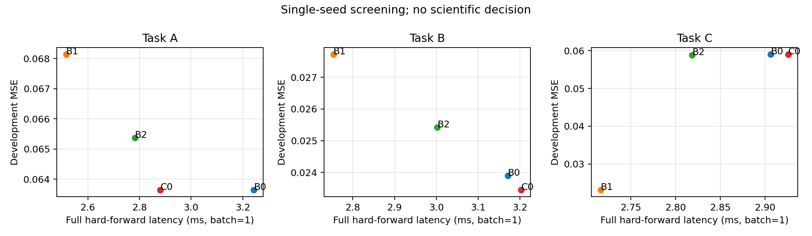
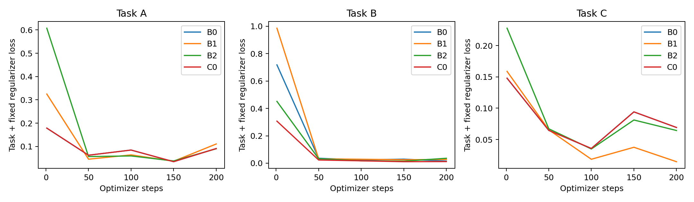

# CLM Native v1 — implementation and screening report

Engineering M0/M1 and the complete preregistered M2 CPU screening are complete. **INCONCLUSIVE**: no scientific support for H1 is claimed. The Task B entry gate failed, so M3/B3/repeats and M4 were not run. Formal confirmation is NOT_REGISTERED; sealed data were not generated/read. No GPU training, paid resources, pretrained models or CLM-Bridge conversion were used.

Frozen implementation: `b56da19d78fe620545fbb1a57e053f7e374a9c68`. Code/config/seed/data/checkpoint identities are in the [raw evidence](../artifacts/m2/b56da19d78fe620545fbb1a57e053f7e374a9c68/evidence.json), [decision](../artifacts/m2/b56da19d78fe620545fbb1a57e053f7e374a9c68/decision.json), and [CSV](../artifacts/m2/b56da19d78fe620545fbb1a57e053f7e374a9c68/summary.csv). Source/configuration were committed before screening. The delivered notebook pins that implementation; later notebook/report commits do not alter its code.

## Engineering validation

33 CPU tests pass, including an independently written Torch vs NumPy solver, no oracle input, bounded private reads, actual message/receiver causality, synchronous updates, no whole-state routing, permutation symmetry, module-shape FLOPs cross-check, useful B2 gradients, joint Cell/router gradients, mixed precision, matched real parameter capacity, checkpoint RNG/identity and legal same-budget restoration. GitHub Actions also passed. The notebook was then executed end-to-end in preflight mode against a real sparse checkout; this caught and fixed a Git-version bootstrap assumption and supports recovery from a partial checkout.

Exact parameter counts: B0/C0 9,475; B1 9,488; B2 9,549; B3 9,474. Maximum spread is 0.792%, under the 5% allowance, with no unused parameter padding. Common operators share initial weights where shapes agree. All four primary arms completed 200 updates × batch eight on each A/B/C task, the same 512 training examples per task and 64 development examples. A separate global-pooling shortcut received the same supervised update budget.

## Measured screening

Inference times below are batch-one resident-input CPU forward medians, measured independently after all training workers exited. They include encoding, scoring, lookup, scheduling, messages, recipient update and output. They exclude data generation, exact target solving, transfer and trace export. They do not predict T4 or large-model performance.

| Task | Arm | Dev MSE | Accuracy at ±0.1 | Full-forward p50 ms |
|---|---|---:|---:|---:|
| A | B0 | 0.063640 | 4.69% | 3.243 |
| A | B1 | 0.068146 | 4.69% | 2.516 |
| A | B2 | 0.065364 | 4.69% | 2.782 |
| A | C0 | 0.063640 | 4.69% | 2.881 |
| B | B0 | 0.023894 | 28.12% | 3.171 |
| B | B1 | 0.027725 | 18.75% | 2.754 |
| B | B2 | 0.025415 | 20.31% | 3.002 |
| B | C0 | 0.023449 | 25.00% | 3.203 |
| C | B0 | 0.059064 | 10.94% | 2.906 |
| C | B1 | 0.023108 | 25.00% | 2.717 |
| C | B2 | 0.058818 | 9.38% | 2.819 |
| C | C0 | 0.059064 | 10.94% | 2.926 |

Primary optimizer-training wall times sum to 128.4 seconds; process startup, data preparation, diagnostic pooling training and profiling are additional and recorded separately. No one-hour manual deadline was imposed.

## Why the protocol stops at M2

Task B C0 MSE 0.023449 vs B0 0.023894 is only a 1.86% relative improvement (minimum entry threshold 5%). Paired per-example difference 95% interval is [-0.007476, 0.006641], which includes zero. C0 accuracy is 25.0% vs B0 28.125%, and latency is about 1.01× B0. There is no reliable quality–cost advantage in this screen. One seed and no B3 evaluation cannot justify either general support or a general theoretical rejection.

Task C supplies the intended negative-control signal: fixed-priority B1 MSE 0.023108 is substantially lower than C0 0.059064. C0 is not naturally superior across tasks. A and C use acyclic computation, so B0 and C0 reduce to the same resident-initial-state recurrence; their identical errors are expected, not evidence of dynamic value.

The zero predictor gets only 1.56% Task B accuracy. POOL does not reach the preregistered 50% shortcut-solved threshold (29.69% accuracy), but its MSE 0.017373 is **better than C0**. Thus the coarse shortcut gate passes while the stronger diagnostic remains worrying: much of the signal may be predictable by global statistics, or the sparse learner may still be undertrained. POOL has more parameters and global information access, so this is a diagnostic warning, not a matched efficiency claim. Do not call the task's communication necessity established.

C0's mean Task B routing entropy is 2.07796, near log(8)=2.07944. Its scores remain weakly differentiated under this budget. Entropy alone cannot establish hard-route collapse or independence; raw paths, repeat counts, state changes, message norms and parameter/initial-state gradient coverage are retained. The biased truncated ST gradient is an explicit learning risk. No loss weight or training duration was changed after observing results.

The public-rule ALG solves A exactly; its NumPy reference CPU p50 is approximately 0.202 ms. It is not capacity-matched neural inference. Learning A would not prove algorithmic efficiency beyond that known executor.

## Evidence boundaries and next decision

H0 passes as engineering only. H1 remains INCONCLUSIVE. Learned H2 causality, H3 OOD and B3/three-seed validation are NOT_RUN under the failed M3 gate. H4 has honest CPU measurements but no demonstrated efficiency advantage. Unit perturbation sensitivity, successful training and plotted routes do not validate CLM.

The implementation includes train-only freezing, legal edge swaps with replay/restoration, equal-cost checks, randomized edges, zero/redistributed messages, larger-N/deeper-path evaluation and reviewed sealed-checkpoint gates. These capabilities were tested for mechanism correctness but were not used to bypass the staged protocol. The central query baseline is implemented and parameter-matched; it is not silently omitted from any positive conclusion because no positive conclusion is made.

Before proposing another version, investigate task communication necessity and route-learning signal using development evidence. Any generator/training change must be versioned and preregistered with the same baseline budget. Do not simply add Cell count, training tokens or GPU runs. Full GPU batching/fused scheduling remains unoptimized, and per-example CPU screening is not a verdict on ultimate hardware efficiency. Larger-N inference includes the O(Nd) encoder cost; bounded candidates do not solve unconstrained content-address discovery.

