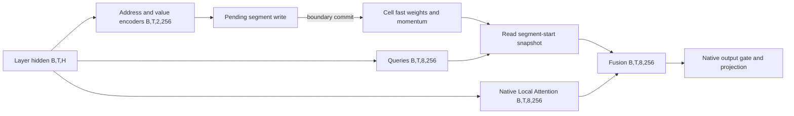

# MiniCells architecture closure

Stage 6C baseline: source 1e5a1a3920d248d7f1153855e13788cbd5cc8e21,
result 3f9d57dcd4c82509b14d879cf37127d62c9ce8bf. The observed checkpoint
SHA256, model, layers and original configuration are in baseline.json.
The weight bytes remain in Kaggle saved Output. The manifest is an
identity record. Durable weight archive readback remains open.

Validation NLL reproduced at 2.6195888435468078. Four language windows
showed E1/E2/E3 NLL 3.8983/3.0693/3.0667. Four factual probes produced
zero exact matches per arm. This supports a predictive effect of the
memory branch and leaves content-specific retrieval unverified.

## Data flow

Each KV group serves four query heads. Keep the 512-token local attention
interface, native DeltaNet and separate absolute position accounting.
Each target layer has independent shards. A full segment reads one
committed snapshot. Validate candidate writes before publishing a new
revision. Persist only declared Cell tensors and metadata.

## Decisions and open gates

- [D1](D1_QK_REPRESENTATION.md) and [D2](D2_MEMORY_ADDRESSING.md) select shared
  pre-RoPE canonical addressing for the first proof. TNT span projection is
  a controlled follow-up. Paraphrase stability remains open.
- [D3](D3_MEMORY_UPDATE.md) and [D4](D4_MEMORY_CAPACITY.md) preserve M3
  initialization, momentum and bounded forgetting as controls. Keep
  segment commits for integration and causal per-fact writes for the
  isolated proof. Capacity and interference attribution remain open.
- [D5](D5_STATE_ARCHITECTURE.md) freezes state ownership and interventions.
  [D6](D6_MEMORY_INTEGRATION.md) defines the normalized residual candidate.
  Language and efficiency acceptance require later execution.

## Stage 7 implementation plan

1. Lock checkpoint, tokenizer, data split hashes, packet templates,
   candidate counts, metrics and thresholds before Test. Keep disjoint
   facts, distractors and donor mappings. Start with one Cell.
2. Run an identical-address positive control, then paired paraphrase
   queries. Score correct, empty, donor and ordinary Qwen on identical
   prompts. Report candidate recall and answer-token metrics separately.
3. Measure recall after initial writes, distractors, contradictory
   updates and attachment of an unrelated Cell. Track old and new
   associations independently after each commit.
4. Export, terminate source, import into a fresh process and repeat the
   read-only queries with empty runtime state. Check state and output
   integrity and reject corrupt or incompatible artifacts.
5. Use a bounded timed pilot with live progress and retained artifacts.
   Freeze the confirmatory budget and paired analysis only after the pilot.
   Require correct-history gains against every control before integration.

Design review complete. Functional and scientific gates await Stage 7.
